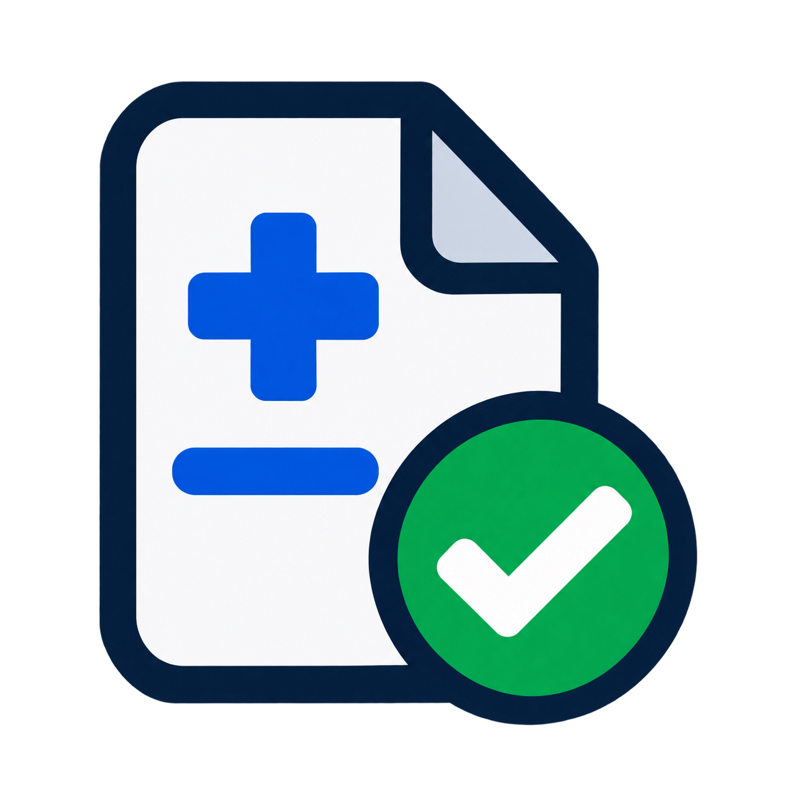
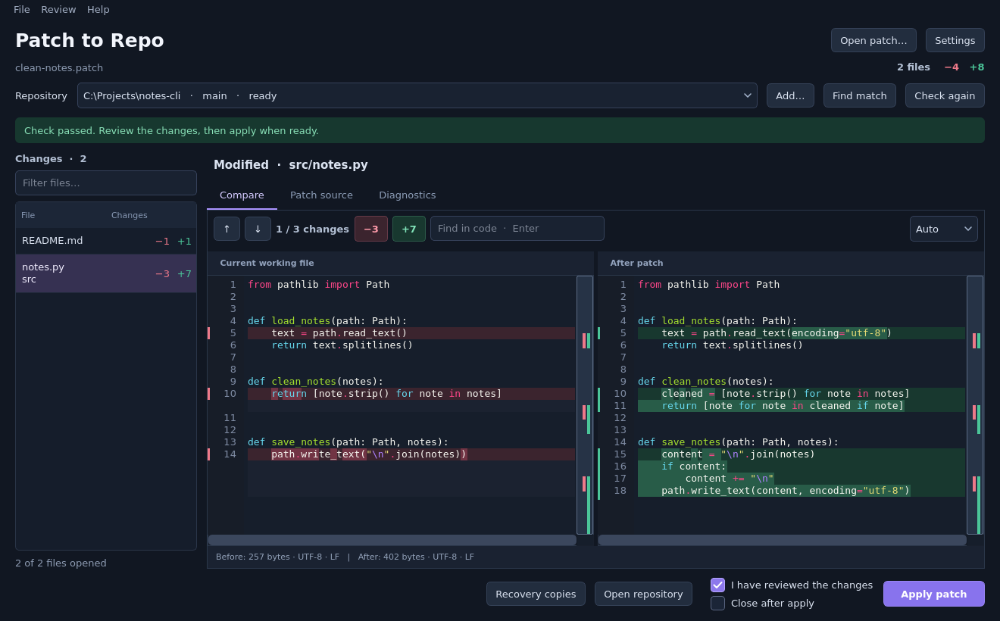

<p align="center">
  
</p>

<h1 align="center">Patch to Repo</h1>

<p align="center">Review Git patches before they touch your working files.</p>

<p align="center">
  <a href="#get-started">Get started</a> ·
  <a href="docs/user-guide.md">User guide</a> ·
  <a href="docs/development.md">Development</a> ·
  <a href="docs/safety.md">Safety & limits</a>
</p>



A desktop patch reviewer with a dark interface, automatic repository matching,
and syntax-highlighted comparisons. Open a patch from Windows Explorer, review
its result, and apply it to your working files. Your index and commits stay untouched.

## Features

- **Find the right repository.** Remember repositories and preselect a unique compatible match.
- **See the full change.** Aligned code panes, syntax highlighting, character-level differences,
  and red/green line counts.
- **Navigate quickly.** Clickable scrollbar markers, linked scrolling, file filtering, code search,
  and previous/next change shortcuts.
- **Apply after review.** Recheck compatibility and reviewed file contents, save recovery copies,
  and verify the result.
- **Fit your workflow.** Edit supported patch drafts, queue incoming patches, and toggle
  **Close after apply** beside the Apply button.

## Get started

You need **Git** and **Python 3.11–3.13 x64**. Python 3.12 is the default used by
setup. The Windows application targets Windows 10 1809+ and Windows 11.

1. Install [Python](https://www.python.org/downloads/windows/) and
   [Git for Windows](https://gitforwindows.org/).
2. Extract this repository and double-click **Setup-Windows.cmd**.
3. Right-click a `.patch` file and choose **Review and apply patch…**
4. Add a repository, inspect the comparison, confirm your review, and select **Apply patch**.

Setup installs into your user profile; no administrator rights are required.
Dependencies need internet during setup. Normal application use works offline.
Windows 11 may place the command under **Show more options**.

For a standalone Windows application, run **Build-Windows.cmd** or download the
Windows artifact from a successful **Actions → CI** run. Keep the entire application
folder together. A built application needs Git but no separate Python installation.

## Review with confidence

The preview includes compatible local edits. Apply repeats the checks and blocks
stale reviews, conflicts, and ambiguous matches. Recovery copies are saved before
writing. A successful check confirms patch compatibility; build and test the patched
project as usual.

Supports Git-format `.patch`, `.diff`, and `.mpatch` files, including text changes,
binary payloads, additions, deletions, and ordinary renames. Some inputs, including
external Git filters such as LFS, are deliberately refused. See
[supported inputs and limits](docs/safety.md) before using unusual patch formats.

**Updates and removal:** close the app and rerun setup to update. Use **Settings →
Remove menu** to remove Explorer integration. Settings and recovery copies are
retained. Details are in the [user guide](docs/user-guide.md#updating-and-removing).

## Development

```sh
python -m pip install '.[dev]'
python -m ruff check .
python -m ruff format --check .
python -m pytest -q
python -m build
```

Tests use disposable Git repositories. For headless Qt tests, set
`QT_QPA_PLATFORM=offscreen`. CI is configured for Windows and Linux; Explorer
integration is Windows-only. See [development and packaging](docs/development.md),
[architecture](docs/architecture.md), and the [validation record](docs/validation.md).

[Contributions](CONTRIBUTING.md) and [security reports](SECURITY.md) are welcome.

## License

[MIT](LICENSE). Dependencies retain their own licenses; see
[third-party notices](THIRD_PARTY_NOTICES.md).
