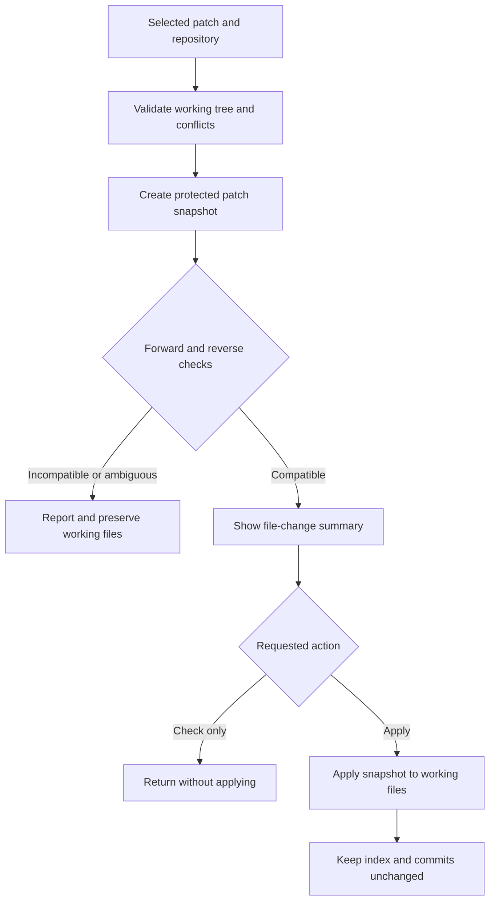

# Architecture

Patch to Repo is a small Windows application with one AutoIt source file. Keeping GUI, setup, and native self-tests together makes interpreted self-installation possible without copying a custom module tree. The public entry point is `PatchToRepo.au3`; build and repository automation live separately.

## Function map

| Responsibility | Main functions |
| --- | --- |
| Arguments and event loop | `_Main`, `_UsageError` |
| Picker creation and validation | `_CreateGUI`, `_ControlsValid` |
| Immutable click capture and operation dispatch | `_QueueAction`, `_RunOperation`, `_ShouldAutoClose` |
| Git validation and patch application | `_ProcessPatch`, `_HasSubmoduleHeaders`, `_Git` |
| Native child processes and capture | `_Exec`, `_OpenInherited`, `_ReadUTF8`, `_TrimUTF8Tail`, `_Quote` |
| Repository history | `_LoadRecent`, `_PromoteRecent`, `_RememberRepo`, `_SaveRecent`, `_ForgetRepo` |
| Setup, icon installation, and removal | `_InstallMenu`, `_InstallFile`, `_RemoveMenu`, `_DeleteShortcut` |
| Snapshot ownership and cleanup | `_CreateSnapshot`, `_ReleaseSnapshot`, `_MakeTempDir`, `_Cleanup` |
| Instance discovery and handoff | `_FindInstanceWindow`, `_ForwardPatch`, `_ReceivePatch` |
| Native test entry point | `_SelfTest`, `_TestPatchWorkflow` |

## Patch lifecycle

Each Apply creates and checks its own snapshot; previous Check results are not cached. The snapshot is copied into an owned temporary directory and held open to deny modification until the operation is released. Submodule-pointer headers are rejected before application. Both check directions passing is ambiguity, not evidence of prior application.

## Windows process boundary

Git runs through `CreateProcessW` with explicit executable selection, correctly quoted arguments, inherited handles selected through a process attribute list, and separate temporary output files. User paths are not interpolated into a command shell. Process handles avoid PID-reuse races; file capture avoids pipe-buffer deadlocks. UTF-8 reads distinguish failure, truncation, and a valid empty result.

A negative internal execution result is not treated as Git's normal incompatible-patch exit. If Git reports a completed apply but capture fails, the UI reports success requiring working-tree review and stays open. During ordinary use, repository configuration and ownership checks remain active; inherited environment variables that redirect Git are removed.

## GUI and single instance

GUI control creation is validated before the loop. A Windows click notification captures the patch and repository values immediately; the loop dispatches that reserved action before presenting an incoming file. Busy-state protection covers Git, modal dialogs, setup, and the completion decision.

Instance discovery checks a dedicated window property and the owning process instead of trusting a window title. An idle picker may acknowledge a new patch. A pending acknowledged patch prevents automatic closing. Selecting a file explicitly through the dialog supersedes an earlier pending handoff.

## Installation ownership

Integration is per user and uses the 64-bit registry view on x64. The application owns only its verb under `.patch` SystemFileAssociations, its application settings, stable helper files, temporary files, and named shortcuts. It does not replace the extension's default association.

Installed files are stage-copied before replacement. Compiled integration points to the stable EXE and its embedded icon. Source integration points to the AutoIt interpreter, installed script, and stable ICO. Uninstall removes the verb and named shortcuts but retains preferences and installed files for reuse. Shortcut deletion uses an API that refuses directories rather than treating a directory as a file mask.

## Test boundary

`--self-test` is recognized before normal startup. It uses disposable files and a unique `PatchToRepoSelfTest-*` registry subtree and can create a hidden GUI. It never intentionally registers the production verb or Start menu shortcuts. Source-mode tests include an intentional runtime-failure probe. The same application functions are exercised in both source and compiled modes.

Python tests independently exercise Git's patch semantics in disposable repositories. They do not execute the AutoIt GUI or prove Windows API behavior. Build/verification tooling and release status are described in [testing](testing.md).
